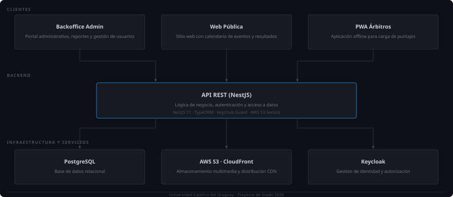

  

 

---

## Repositorios

| Repositorio | Descripción | Stack |
|---|---|---|
| [**adic-platform-api**](https://github.com/Proyecto-ADIC/adic-platform-api) | REST API backend — gestión de competencias, inscripciones, puntajes y sincronización offline | NestJS · TypeORM · PostgreSQL · Keycloak · AWS S3 |
| [**adic-platform-web**](https://github.com/Proyecto-ADIC/adic-platform-web) | Sitio web público — calendario de eventos, resultados y galería multimedia | Angular 21 · Angular Material |
| [**adic-platform-backoffice**](https://github.com/Proyecto-ADIC/adic-platform-backoffice) | Portal administrativo — CRUD completo, reportes PDF con QR y autorización de dispositivos | Angular 21 · Tailwind CSS · jsPDF |
| [**adic-platform-pwa**](https://github.com/Proyecto-ADIC/adic-platform-pwa) | App Progressive Web App para árbitros — offline-first con sincronización automática | Angular 21 · Service Worker · Dexie (IndexedDB) |
| [**adic-platform-infra**](https://github.com/Proyecto-ADIC/adic-platform-infra) | Infraestructura como código — EC2, S3, CloudFront, ECR, IAM y CI/CD | Terraform · AWS · GitHub Actions · Docker |

---

## Ecosistema

  

---

## Módulos principales

**Gestión deportiva**
- **Competencias** — creación y administración de eventos deportivos
- **Disciplinas y categorías** — estructura jerárquica configurable
- **Inscripciones** — registro de competidores por evento
- **Puntajes** — evaluación por plantillas configurables
- **Resultados** — cálculo y publicación de clasificaciones

**Operaciones**
- **Carnet deportivo** — emisión y gestión de carnets por competidor
- **Instituciones** — gestión de clubes y organizaciones afiliadas
- **Gestión de usuarios** — roles y permisos vía Keycloak
- **Reportes** — exportación a PDF con QR y Excel

**PWA offline-first**
- Descarga de bundle de competencia para trabajo sin conectividad
- Almacenamiento local en IndexedDB (Dexie)
- Autorización de dispositivo por código único / QR
- Sincronización automática al recuperar conexión

---

## Stack tecnológico

| Capa | Tecnologías |
|---|---|
| **Backend** | NestJS 11 · TypeScript 5.7 · TypeORM 0.3 · PostgreSQL 16 |
| **Frontend** | Angular 21 (Standalone) · Angular Material 21 · SCSS · Tailwind CSS 4 |
| **Auth** | Keycloak (OpenID Connect) · JWT Bearer · RBAC |
| **Storage** | AWS S3 · CloudFront · IndexedDB (Dexie) |
| **Infra** | AWS EC2 · ECR · SSM · Terraform 1.10 |
| **CI/CD** | GitHub Actions · GitHub OIDC · Docker Compose |
| **Testing** | Jest · Supertest · Vitest |

---

  Proyecto de Grado · Universidad Católica del Uruguay · 2026

